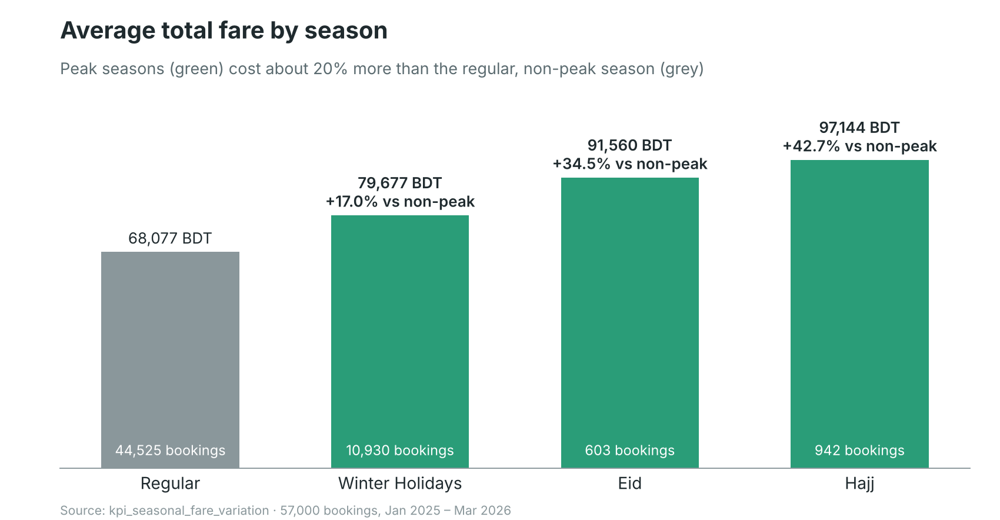
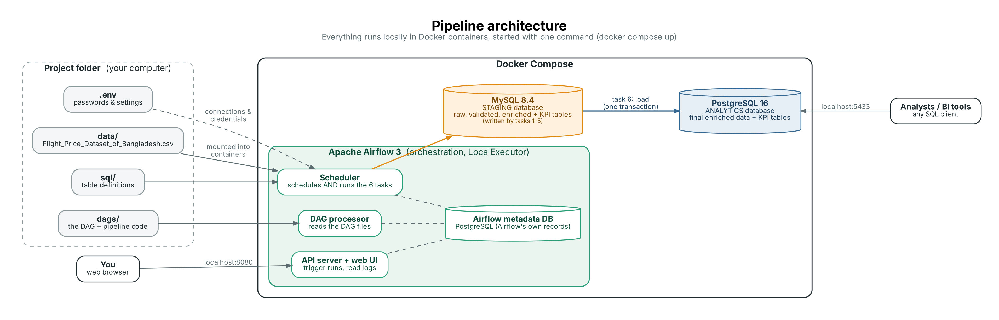
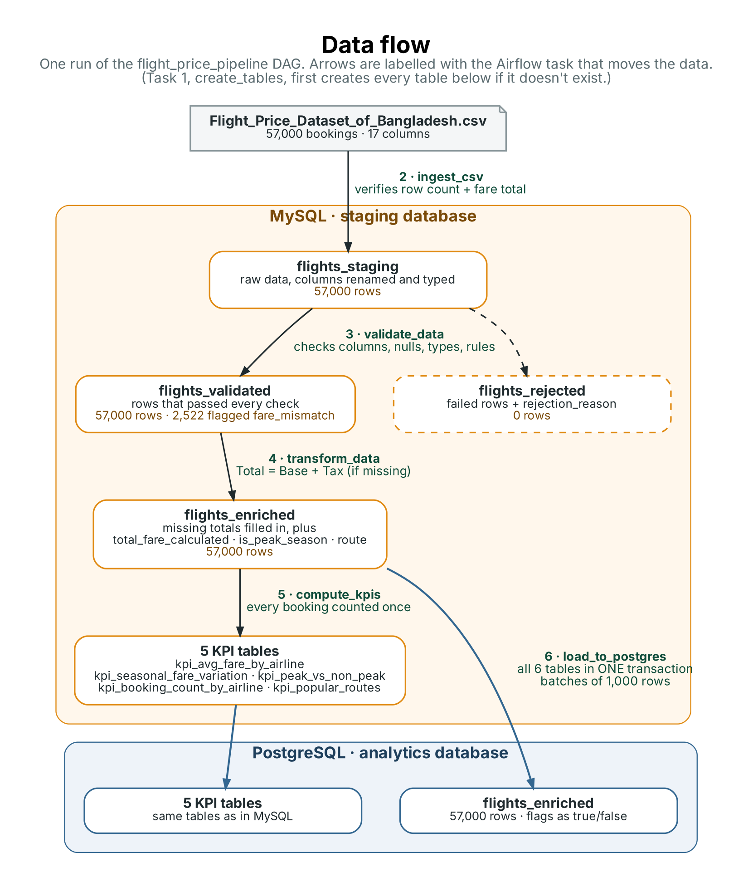

# Flight Price Analysis: an Apache Airflow Data Pipeline

An end-to-end, fully automated data pipeline that processes the **Flight Price Dataset of Bangladesh** (57,000 bookings). Apache Airflow loads the raw CSV into a MySQL staging database, validates and transforms the data, computes four KPIs, and delivers the results to a PostgreSQL analytics database.

**Headline result:** fares in peak travel seasons (Eid, Hajj and Winter Holidays) average **20% higher** than regular fares, and Hajj fares are **43% higher**.



---

## Contents

1. [Project deliverables](#1-project-deliverables)
2. [Requirements checklist](#2-requirements-checklist)
3. [Pipeline architecture](#3-pipeline-architecture)
4. [Data flow](#4-data-flow)
5. [The Airflow DAG and its tasks](#5-the-airflow-dag-and-its-tasks)
6. [Data validation](#6-data-validation)
7. [KPIs: definitions, logic and results](#7-kpis-definitions-logic-and-results)
8. [Key design decisions](#8-key-design-decisions)
9. [Challenges and how they were resolved](#9-challenges-and-how-they-were-resolved)
10. [Running the project](#10-running-the-project)
11. [Repository structure](#11-repository-structure)
12. [Possible improvements](#12-possible-improvements)

---

## 1. Project deliverables

| Deliverable | File | Description |
|---|---|---|
| **Project report** | [Report.pdf](docs/Report.pdf) | Non-technical report for stakeholders: findings, how the pipeline works, data quality, KPIs, challenges and next steps |
| **Project brief** | [Airflow-Project.md](Airflow-Project.md) | The original project description and requirements |
| **Source data** | [data/Flight_Price_Dataset_of_Bangladesh.csv](data/Flight_Price_Dataset_of_Bangladesh.csv) | The raw dataset the pipeline processes (57,000 bookings, from Kaggle) |
| **Airflow DAG** | [dags/flight_price_pipeline.py](dags/flight_price_pipeline.py) | The pipeline definition: six tasks, their order, documentation, retries and alerts |
| **Pipeline code** | [dags/pipeline/](dags/pipeline/) | One Python module per stage (ingest, validate, transform, KPIs, load) plus shared helpers |
| **Database schemas** | [sql/mysql_tables.sql](sql/mysql_tables.sql), [sql/postgres_tables.sql](sql/postgres_tables.sql) | Table definitions with explicit column types |
| **Infrastructure** | [docker-compose.yaml](docker-compose.yaml), [.env.example](.env.example) | Runs Airflow, MySQL and PostgreSQL locally |
| **Diagrams** | [docs/images/](docs/images/) | Architecture and data flow diagrams shown below |

---

## 2. Requirements checklist

How each requirement in the [project brief](Airflow-Project.md) is met:

| Requirement | Implementation |
|---|---|
| Load the CSV into a MySQL staging table | `ingest_csv` loads all 57,000 rows into `flights_staging` |
| Correct insertion with appropriate column types | Explicit `CREATE TABLE` types (`DATETIME`, `DECIMAL(12,2)`, `INT`, sized `VARCHAR`); the task verifies the row count and fare total against the CSV |
| All required columns exist | `validate_data` checks for Airline, Source, Destination, Base Fare, Tax & Surcharge and Total Fare before checking any rows |
| Handle missing or null values | Rows missing required values are rejected with a reason; a missing total fare is calculated instead |
| Validate data types | Fares and numbers must be numeric, dates must be valid, text must not be blank |
| Flag or correct inconsistencies | Corrects whitespace and code case; rejects negative/zero fares, invalid airport codes and more; flags 2,522 fare mismatches |
| Total Fare = Base Fare + Tax & Surcharge, if not present | `transform_data` fills missing totals only, and records which totals were calculated |
| KPIs: average fare by airline, seasonal variation, booking count by airline, popular routes | `compute_kpis` writes five KPI tables (Section 7) |
| Transfer enriched data to PostgreSQL with minimal latency and consistency | `load_to_postgres` uses batched inserts (latency) and one transaction for all tables (consistency) |
| Documentation | This README (technical) and the [project report](docs/Flight_Price_Analysis_Report.pptx) (non-technical) |

---

## 3. Pipeline architecture



Everything runs locally in Docker containers defined in [docker-compose.yaml](docker-compose.yaml):

| Container | Role |
|---|---|
| `airflow-apiserver` | Airflow web UI and API at http://localhost:8080 |
| `airflow-scheduler` | Schedules the tasks and, with the **LocalExecutor**, also runs them |
| `airflow-dag-processor` | Reads the DAG files from `dags/` |
| `postgres` | Airflow's own metadata database (not used for project data) |
| `mysql` | **Staging** database `flights_staging` (reachable at `localhost:3307`) |
| `postgres-analytics` | **Analytics** database `flights_analytics` (reachable at `localhost:5433`) |

- The project folders `dags/`, `data/` and `sql/` are mounted into the Airflow containers at `/opt/airflow/...`, so the code, the CSV and the table definitions are available to the tasks without rebuilding anything.
- The two project database connections are defined as environment variables (`AIRFLOW_CONN_MYSQL_STAGING`, `AIRFLOW_CONN_POSTGRES_ANALYTICS`) whose credentials come from the `.env` file, which is excluded from Git.
- MySQL is the pipeline's **working area**: every intermediate result is kept there, which makes each stage easy to inspect and re-run. Only the final, analysis-ready tables are copied to PostgreSQL, so people using the results never see work in progress.

---

## 4. Data flow



| Table | Database | Rows | Contents |
|---|---|---|---|
| `flights_staging` | MySQL | 57,000 | Raw CSV data with renamed, typed columns and an auto-increment `id` |
| `flights_validated` | MySQL | 57,000 | Rows that passed validation, plus a `fare_mismatch` flag |
| `flights_rejected` | MySQL | 0 | Rows that failed validation, with a `rejection_reason` |
| `flights_enriched` | MySQL, then PostgreSQL | 57,000 | Validated rows plus `total_fare_calculated`, `is_peak_season` and `route` |
| 5 × `kpi_*` tables | MySQL, then PostgreSQL | 2 to 152 | One table per KPI (Section 7) |

---

## 5. The Airflow DAG and its tasks

One DAG, `flight_price_pipeline` ([dags/flight_price_pipeline.py](dags/flight_price_pipeline.py)), runs six tasks in a straight line:

```
create_tables >> ingest_csv >> validate_data >> transform_data >> compute_kpis >> load_to_postgres
```

Each task needs the previous task's output, so the DAG is linear. Under Airflow's default `all_success` trigger rule, a task only runs if its upstream task succeeded; otherwise it is marked `upstream_failed`. The DAG has no schedule (`schedule=None`) and is triggered manually, because the source is a single static file. Its description (`doc_md`) and every task's docstring are shown in the Airflow UI.

| # | Task | Reads | Writes | What it does | Self-check |
|---|---|---|---|---|---|
| 1 | `create_tables` | `sql/*.sql` | all tables | Runs `CREATE TABLE IF NOT EXISTS` in both databases | (safe to run every time) |
| 2 | `ingest_csv` | the CSV | `flights_staging` | Checks the 17 expected columns exist, renames them to snake_case, converts dates and numbers (fares rounded to 2 decimals), empties the table and inserts all rows in batches of 5,000 | Row count and sum of total fares must match the CSV |
| 3 | `validate_data` | `flights_staging` | `flights_validated`, `flights_rejected` | Checks required columns, then corrects, rejects or flags every row (Section 6) | Validated + rejected rows must equal staged rows; at least one row valid |
| 4 | `transform_data` | `flights_validated` | `flights_enriched` | Fills missing totals (Base + Tax), adds `total_fare_calculated`, `is_peak_season` and `route` | No rows lost; no total fare still missing |
| 5 | `compute_kpis` | `flights_enriched` | 5 `kpi_*` tables | Computes the four KPIs with pandas `groupby` | In every count-based KPI, booking counts must add up to the total |
| 6 | `load_to_postgres` | `flights_enriched` + KPI tables | same 6 tables in PostgreSQL | Replaces all six tables in **one transaction**, with batched inserts | Each table's row count is checked before committing |

**Retries and alerts.** Through `default_args`, every task is retried once after one minute. If it fails again, the `on_failure_callback` ([dags/pipeline/alerts.py](dags/pipeline/alerts.py)) writes a clearly marked `PIPELINE FAILURE ALERT` (DAG, task, run, attempt and error) to the task log.

**Code organisation.** The DAG file only declares tasks and their order; each task calls one function in the `pipeline` package. The data logic in each stage (`clean_and_check`, `enrich`, the KPI functions) works on pandas DataFrames only and never touches a database, so it can be tested on its own.

| Module | Contents |
|---|---|
| [config.py](dags/pipeline/config.py) | Connection IDs, paths, table names, the column mapping and validation rules |
| [db.py](dags/pipeline/db.py) | `read_query`, `dataframe_to_rows`, `replace_table_contents` |
| [tables.py](dags/pipeline/tables.py) | Runs the SQL files |
| [ingest.py](dags/pipeline/ingest.py), [validate.py](dags/pipeline/validate.py), [transform.py](dags/pipeline/transform.py), [kpis.py](dags/pipeline/kpis.py), [load.py](dags/pipeline/load.py) | One module per stage |
| [alerts.py](dags/pipeline/alerts.py) | The failure alert callback |

---

## 6. Data validation

Exploring the dataset first ([exploration/explore_dataset.py](exploration/explore_dataset.py)) showed it to be very clean: no nulls, no negative or zero fares, no duplicates, valid dates, arrival always after departure, and no flight with the same origin and destination. The pipeline still checks everything, because a future file might not be clean.

| Type | Rule |
|---|---|
| **Structure** | The six required columns must exist, or the task fails immediately |
| **Corrected** | Leading/trailing spaces trimmed; blank text treated as missing; airport codes uppercased |
| **Rejected: missing** | `airline`, `source`, `destination`, `base_fare_bdt`, `tax_surcharge_bdt`, `seasonality` must be present (a missing `total_fare_bdt` is calculated later instead) |
| **Rejected: types** | Numeric fields must be numbers; dates must be valid |
| **Rejected: rules** | Base fare > 0; tax ≥ 0; total fare > 0 if present; airport codes match `[A-Z]{3}`; source ≠ destination; arrival after departure; season is Regular, Winter Holidays, Eid or Hajj |
| **Flagged, kept** | `fare_mismatch = 1` when total fare differs from base fare + tax by more than 1 BDT |

A row can fail several rules; all reasons are recorded, separated by semicolons.

**Result:** all 57,000 rows passed and 0 were rejected. The rejection path was tested by inserting deliberately broken rows into `flights_staging` and re-running only `validate_data` (Airflow's *Clear* action); every broken row was rejected with the correct reasons.

**The fare mismatch finding.** In 2,522 rows (4.4%), the total fare is **exactly 1.2 ×** (base fare + tax), as if an unexplained 20% charge had been applied, across all seasons and classes. Because the pattern looks deliberate rather than erroneous, and the brief only asks to calculate the total "if not already present," these rows keep their original totals and are flagged rather than corrected or rejected.

---

## 7. KPIs: definitions, logic and results

Each row is one booking, so **booking count** = number of rows. Averages use `total_fare_bdt` and include the flagged mismatch rows (their totals are the fares recorded in the file; the flag allows excluding them later). The overall average fare is **71,030 BDT**.

### Average Fare by Airline (`kpi_avg_fare_by_airline`)

Group by `airline`, mean of `total_fare_bdt`, sorted highest first. The 24 airlines fall in a narrow band: from **75,547 BDT** (Turkish Airlines) to **68,108 BDT** (Vistara), only about 11% apart.

### Seasonal Fare Variation (`kpi_seasonal_fare_variation`, `kpi_peak_vs_non_peak`)

Peak seasons are **Eid, Hajj and Winter Holidays**; non-peak is **Regular**. Average fare per season and per season type, with `pct_diff_vs_non_peak = (season avg − non-peak avg) / non-peak avg × 100`.

| Season | Type | Bookings | Avg fare (BDT) | vs non-peak |
|---|---|---|---|---|
| Hajj | Peak | 942 | 97,144 | +42.7% |
| Eid | Peak | 603 | 91,560 | +34.5% |
| Winter Holidays | Peak | 10,930 | 79,677 | +17.0% |
| Regular | Non-Peak | 44,525 | 68,077 | 0.0% |
| **All peak seasons** | Peak | 12,475 | 81,570 | **+19.8%** |

### Booking Count by Airline (`kpi_booking_count_by_airline`)

Group by `airline`, count rows; share = count / total × 100. **US-Bangla Airlines** leads with **4,496 bookings (7.9%)**, about twice any other airline; the other 23 have between 2,201 and 2,368 each.

### Most Popular Routes (`kpi_popular_routes`)

Group by route (direction matters: DAC-CXB ≠ CXB-DAC), count bookings and average the fare; rank by bookings, ties broken alphabetically by route so the ranking is identical on every run.

| Rank | Route | Bookings | Avg fare (BDT) |
|---|---|---|---|
| 1 | Rajshahi → Singapore (RJH-SIN) | 417 | 113,963 |
| 2 | Dhaka → Dubai (DAC-DXB) | 413 | 104,942 |
| 3 | Barisal → Toronto (BZL-YYZ) | 410 | 107,844 |
| 4 | Chittagong → Bangkok (CGP-BKK) | 408 | 107,170 |
| 5 | Cox's Bazar → Delhi (CXB-DEL) | 408 | 100,161 |

All 152 routes have between 310 and 417 bookings. Domestic routes such as Chittagong → Cox's Bazar (rank 7, about 7,700 BDT) are popular and far cheaper than international ones.

> **Caveat:** bookings are spread unusually evenly across routes and 23 of the 24 airlines, which suggests the dataset may be partly synthetic. The seasonal effect is large and consistent; the airline and route rankings should be interpreted with care.

---

## 8. Key design decisions

- **Data moves between tasks through tables, not XCom.** XCom carries only each task's small summary dictionary (row counts), visible in the task's XCom tab.
- **Every task is idempotent.** Each task empties its target table before writing (full refresh), so re-runs and automatic retries never duplicate data.
- **Every task verifies its own output** and fails loudly if rows were lost or double-counted.
- **Staging allows NULLs on purpose:** it stores data exactly as it arrived; deciding validity is the validation task's job.
- **One transaction for the final load.** All six PostgreSQL tables are replaced inside a single transaction and committed only after every row count check passes, so they switch to the new data at the same instant. A deliberately failed load was confirmed to roll back with the previous data intact. `DELETE` is used instead of `TRUNCATE`, so readers keep seeing the old data during a load instead of being locked out.
- **Batched inserts:** 1,000 rows per `INSERT` cuts round trips from 57,000 to 57; the load takes a few seconds. The size also respects PostgreSQL's limit of 65,535 placeholders per statement (22 columns × 1,000 rows = 22,000).
- **All values are passed through query placeholders**, so the driver safely handles quoting (e.g. "Cox's Bazar"), `NULL`s and types.
- **Settings live in one place** ([config.py](dags/pipeline/config.py)); e.g. changing which seasons count as peak is a one-line edit.

---

## 9. Challenges and how they were resolved

| # | Challenge | Resolution |
|---|---|---|
| 1 | `docker-compose up` failed: "failed to connect to the docker API" | Docker Desktop was installed but not running; starting it fixed the error |
| 2 | Warnings for `AIRFLOW_UID` and `FERNET_KEY` | Fixed a typo in `.env` (`AIRFLOW_DID`) and generated a Fernet key to encrypt stored connection credentials |
| 3 | Initialisation failed with `NoSuchModuleError: postgresql.psycopg`; the API server stayed unhealthy | `.env` pinned the Airflow image to 3.0.0 while the compose file was written for 3.4.0, whose driver (psycopg 3) the old image lacked. Removing the pin aligned the versions. The init container still reported success because its script continues after errors, so the real error was only visible in its output |
| 4 | Docker had only about 3.6 GB of memory (4 GB recommended); containers were slow to become healthy | Switched from the CeleryExecutor to the LocalExecutor (removing Redis, the Celery worker and the triggerer), disabled MySQL's `performance_schema` and turned off the example DAGs |
| 5 | Column names such as `Tax & Surcharge (BDT)` are awkward in SQL | Renamed all columns to snake_case through one mapping; `Class` became `travel_class` and the ranking column is `route_rank`, since `class` and `rank` are reserved words in Python and MySQL |
| 6 | 2,522 totals did not equal base fare + tax | Investigated the pattern (exactly 1.2×), kept and flagged the rows |
| 7 | A clean dataset left the rejection logic untested | Planted broken rows in staging and re-ran only the validation task |
| 8 | Re-runs and retries could duplicate data | Every task empties its target table before loading |
| 9 | pandas/numpy types and MySQL `Decimal` values are not accepted directly by the drivers | Shared helpers convert values in both directions (`pd.to_numeric` when reading; plain Python values and `None` when writing) |
| 10 | MySQL stores flags as 1/0, but PostgreSQL `BOOLEAN` needs true/false | The load step converts the flag columns explicitly |
| 11 | A failure midway through loading could leave PostgreSQL partly updated | Single-transaction load with count checks before commit |

---

## 10. Running the project

### Prerequisites

- Docker Desktop, with about 4 GB of memory available to Docker

### Setup

1. **Clone the repository** and open a terminal in the project folder.
2. **The dataset is already included** at `data/Flight_Price_Dataset_of_Bangladesh.csv`, so there's nothing to download. (Source: *Flight Price Dataset of Bangladesh* on Kaggle.)
3. **Create `.env`** by copying [.env.example](.env.example) and filling in the values. Generate a Fernet key with:

   ```
   docker run --rm apache/airflow:3.4.0 python -c "from cryptography.fernet import Fernet; print(Fernet.generate_key().decode())"
   ```

   Use only letters and digits in the database passwords, because they are used inside connection URLs.

4. **Create the folders Airflow uses**, if they don't exist:

   ```
   mkdir dags, logs, plugins, config, data, sql      # PowerShell
   mkdir -p dags logs plugins config data sql        # macOS / Linux
   ```

5. **Start everything:**

   ```
   docker compose up airflow-init
   docker compose up -d
   ```

6. Open **http://localhost:8080** and log in with `airflow` / `airflow`.

### Run the pipeline

In the Airflow UI, open `flight_price_pipeline`, switch the DAG on and click **Trigger**. All six tasks should turn green; each task's log ends with a summary of what it did.

### Check the results

```
docker compose exec mysql mysql -u <MYSQL_USER> -p<MYSQL_PASSWORD> <MYSQL_DATABASE> -e "SELECT COUNT(*) FROM flights_staging; SELECT COUNT(*) FROM flights_validated; SELECT COUNT(*) FROM flights_rejected;"

docker compose exec postgres-analytics psql -U <ANALYTICS_USER> -d <ANALYTICS_DB> -c "SELECT * FROM kpi_peak_vs_non_peak;"
```

Both databases are also reachable from any SQL client: MySQL at `localhost:3307`, PostgreSQL at `localhost:5433`.

### Stop

```
docker compose down        # add -v to also delete all database data
```

---

## 11. Repository structure

```
├── dags/
│   ├── flight_price_pipeline.py                      # The DAG: tasks, order, docs, retries, alerts
│   └── pipeline/                                     # The logic, one module per stage
├── sql/
│   ├── mysql_tables.sql                              # Staging table definitions
│   └── postgres_tables.sql                           # Analytics table definitions
├── docs/
│   ├── Flight_Price_Analysis_Report.pptx             # Non-technical project report
│   └── images/                                       # Diagrams and charts used in this README
├── data/
│   └── Flight_Price_Dataset_of_Bangladesh.csv        # Source data (from Kaggle)
├── Airflow-Project.md                                # Project brief
├── docker-compose.yaml
├── .env.example                                      # Template for .env
└── README.md
```

---

## 12. Possible improvements

- **Email alerts:** the alert callback is isolated in [alerts.py](dags/pipeline/alerts.py), so sending email (e.g. Python's `smtplib` with a Gmail app password) only changes that file.
- **Scheduling and incremental loads** if new data files arrive regularly.
- **Unit tests** with pytest for the DataFrame-only functions.
- **City name validation** against a reference list of airports, in addition to the code format check.
- **Load `flights_rejected` into PostgreSQL** for data quality reporting.